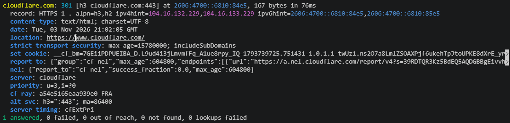

# Sample output

One host, asked for its records over DNS over TLS. This is how the result looks in a terminal:

```sh
build/http-probe --dot --dns-server one.one.one.one cloudflare.com
```



The same with `-vv`, without the colours and without the QUIC trace, which is a lot more. The lines
with a time in front are the log, and the `---` lines are the turns of the event loop, both on stderr.
The two tokens in `set-cookie` and `report-to` are cut short to `…`.

<!-- cspell:disable -->

```text
21:01:20.511 debug looking up DNS server 'one.one.one.one'
21:01:20.511 debug ares_getaddrinfo(one.one.one.one, )...
21:01:20.511 debug socket state: fd=5 readable=true writable=false
--- 0 ------------------------------------------------------------------------
--- 1 ------------------------------------------------------------------------
--- 2 ------------------------------------------------------------------------
--- 3 ------------------------------------------------------------------------
--- 4 ------------------------------------------------------------------------
--- 5 ------------------------------------------------------------------------
--- 6 ------------------------------------------------------------------------
21:01:20.513 debug ares_getaddrinfo: Successful completion (0 timeout(s))
21:01:20.513 debug socket state: fd=5 readable=false writable=false
--- 7 ------------------------------------------------------------------------
21:01:20.520 debug using DNS server(s) 1.1.1.1:853
--- 8 ------------------------------------------------------------------------
--- 9 ------------------------------------------------------------------------
21:01:20.520 debug cloudflare.com: asking for the HTTPS records of 'cloudflare.com'
21:01:20.520 debug ares_search_dnsrec(cloudflare.com, HTTPS)...
21:01:20.520 debug socket state: fd=5 readable=true writable=true
--- 10 ------------------------------------------------------------------------
--- 11 ------------------------------------------------------------------------
--- 12 ------------------------------------------------------------------------
--- 13 (20ms) ----------------------------------------------------------------
21:01:20.558 info fd=5 TLS established: TLSv1.3, cipher=TLS_AES_256_GCM_SHA384, group=X25519MLKEM768
21:01:20.558 info fd=5 TLS peer: subject=CN=cloudflare-dns.com,O=Cloudflare\, Inc.,L=San Francisco,ST=California,C=US, issuer=CN=SSL.com SSL Intermediate CA ECC R2,O=SSL Corp,L=Houston,ST=Texas,C=US, verified
--- 14 (17ms) ----------------------------------------------------------------
--- 15 ------------------------------------------------------------------------
--- 16 ------------------------------------------------------------------------
--- 17 ------------------------------------------------------------------------
--- 18 ------------------------------------------------------------------------
21:01:20.558 debug socket state: fd=5 readable=true writable=false
--- 19 ------------------------------------------------------------------------
--- 20 ------------------------------------------------------------------------
21:01:20.587 debug ares_search_dnsrec: Successful completion (0 timeout(s))
--- 21 (28ms) ----------------------------------------------------------------
21:01:20.587 debug cloudflare.com: asking for the addresses of 'cloudflare.com'
21:01:20.587 debug ares_getaddrinfo(cloudflare.com, )...
--- 22 ------------------------------------------------------------------------
--- 23 ------------------------------------------------------------------------
--- 24 ------------------------------------------------------------------------
--- 25 (16ms) ----------------------------------------------------------------
--- 26 ------------------------------------------------------------------------
--- 27 ------------------------------------------------------------------------
21:01:20.604 debug ares_getaddrinfo: Successful completion (0 timeout(s))
--- 28 ------------------------------------------------------------------------
21:01:20.604 debug cloudflare.com: connecting to 2606:4700::6810:84e5 by h3 cloudflare.com:443, for HTTPS 1 . alpn=h3,h2 ipv4hint=104.16.132.229,104.16.133.229 ipv6hint=2606:4700::6810:84e5,2606:4700::6810:85e5
21:01:20.604 info [client] ctor
21:01:20.609 debug [h3:[2606:4700::6810:84e5]:443] session created
21:01:20.609 debug [h3:[2606:4700::6810:84e5]:443] connecting, scid=aa5ea0b70edeec45f5f093e097f0097f38
21:01:20.609 debug [h3:[2606:4700::6810:84e5]:443] write_streams: max_data_left=0
--- 29 ------------------------------------------------------------------------
--- 30 ------------------------------------------------------------------------
--- 31 ------------------------------------------------------------------------
--- 32 ------------------------------------------------------------------------
21:01:20.633 debug [h3:[2606:4700::6810:84e5]:443] on_read: 1200 bytes
21:01:20.634 debug [h3:[2606:4700::6810:84e5]:443] write_streams: max_data_left=0
--- 33 (23ms) ----------------------------------------------------------------
--- 34 ------------------------------------------------------------------------
--- 35 ------------------------------------------------------------------------
21:01:20.634 debug [h3:[2606:4700::6810:84e5]:443] on_read: 1200 bytes
21:01:20.634 debug [h3:[2606:4700::6810:84e5]:443] write_streams: max_data_left=0
21:01:20.634 debug [h3:[2606:4700::6810:84e5]:443] on_read: 1200 bytes
21:01:20.635 debug [h3:[2606:4700::6810:84e5]:443] write_streams: max_data_left=0
21:01:20.635 debug [h3:[2606:4700::6810:84e5]:443] on_read: 1200 bytes
21:01:20.635 debug [h3:[2606:4700::6810:84e5]:443] write_streams: max_data_left=0
21:01:20.635 debug [h3:[2606:4700::6810:84e5]:443] on_read: 619 bytes
21:01:20.636 debug [h3:[2606:4700::6810:84e5]:443] HTTP/3 ready (ctrl=2 qpack_enc=6 qpack_dec=10)
21:01:20.636 info [h3:[2606:4700::6810:84e5]:443] connected, h3 over QUIC (version=0x1, scid=aa5ea0b70edeec45f5f093e097f0097f38, TLSv1.3, cipher=TLS_AES_256_GCM_SHA384, group=X25519MLKEM768, alpn=h3)
21:01:20.636 debug [h3:[2606:4700::6810:84e5]:443] write_streams: max_data_left=10000000
21:01:20.636 debug [h3:[2606:4700::6810:84e5]:443] write_pkt: nghttp3_conn_writev_stream -> stream=2 sveccnt=1 fin=0
21:01:20.636 debug [h3:[2606:4700::6810:84e5]:443] write_pkt: nghttp3_conn_writev_stream -> stream=10 sveccnt=1 fin=0
21:01:20.636 debug [h3:[2606:4700::6810:84e5]:443] write_pkt: nghttp3_conn_writev_stream -> stream=6 sveccnt=1 fin=0
21:01:20.636 debug [h3:[2606:4700::6810:84e5]:443] write_pkt: nghttp3_conn_writev_stream -> stream=-1 sveccnt=0 fin=0
21:01:20.636 debug [h3:[2606:4700::6810:84e5]:443] write_pkt: nghttp3_conn_writev_stream -> stream=-1 sveccnt=0 fin=0
--- 36 ------------------------------------------------------------------------
--- 37 ------------------------------------------------------------------------
--- 38 ------------------------------------------------------------------------
--- 39 ------------------------------------------------------------------------
21:01:20.636 debug Session::move: use_count=2
--- 40 ------------------------------------------------------------------------
--- 41 ------------------------------------------------------------------------
--- 42 ------------------------------------------------------------------------
21:01:20.636 debug [h3:[2606:4700::6810:84e5]:443.0] Stream: ctor
21:01:20.636 debug [h3:[2606:4700::6810:84e5]:443.0] GET https://cloudflare.com/
21:01:20.636 debug [h3:[2606:4700::6810:84e5]:443.0]   :method: GET
21:01:20.636 debug [h3:[2606:4700::6810:84e5]:443.0]   :scheme: https
21:01:20.636 debug [h3:[2606:4700::6810:84e5]:443.0]   :path: /
21:01:20.636 debug [h3:[2606:4700::6810:84e5]:443.0]   :authority: cloudflare.com
21:01:20.636 debug [h3:[2606:4700::6810:84e5]:443.0]   User-Agent: http-probe/0.0.1 (+https://github.com/pgit/http-probe)
21:01:20.636 debug [h3:[2606:4700::6810:84e5]:443.0]   Content-Length: 0
21:01:20.636 debug [h3:[2606:4700::6810:84e5]:443.0] async_submit: new stream ID: 0
21:01:20.636 debug [h3:[2606:4700::6810:84e5]:443.0] Client::Request: ctor
21:01:20.636 debug [h3:[2606:4700::6810:84e5]:443.0] start_write: n=0 eof=true
--- 43 ------------------------------------------------------------------------
21:01:20.636 debug [h3:[2606:4700::6810:84e5]:443] write_streams: max_data_left=9999984
21:01:20.636 debug [h3:[2606:4700::6810:84e5]:443] write_pkt: nghttp3_conn_writev_stream -> stream=0 sveccnt=1 fin=1
--- 44 ------------------------------------------------------------------------
--- 45 ------------------------------------------------------------------------
--- 46 ------------------------------------------------------------------------
--- 47 ------------------------------------------------------------------------
--- 48 ------------------------------------------------------------------------
21:01:20.652 debug [h3:[2606:4700::6810:84e5]:443] on_read: 561 bytes
21:01:20.652 debug [h3:[2606:4700::6810:84e5]:443] write_streams: max_data_left=9999984
21:01:20.652 debug [h3:[2606:4700::6810:84e5]:443] write_pkt: nghttp3_conn_writev_stream -> stream=0 sveccnt=1 fin=1
21:01:20.652 debug [h3:[2606:4700::6810:84e5]:443] write_pkt: nghttp3_conn_writev_stream -> stream=-1 sveccnt=0 fin=0
21:01:20.652 debug [h3:[2606:4700::6810:84e5]:443] write_pkt: nghttp3_conn_writev_stream -> stream=-1 sveccnt=0 fin=0
21:01:20.652 debug [h3:[2606:4700::6810:84e5]:443] on_read: 64 bytes
21:01:20.652 debug [h3:[2606:4700::6810:84e5]:443] cb_recv_stream_data: stream=3 offset=0 datalen=24 fin=false ready=true
21:01:20.652 debug [h3:[2606:4700::6810:84e5]:443] write_streams: max_data_left=9999921
21:01:20.652 debug [h3:[2606:4700::6810:84e5]:443] write_pkt: nghttp3_conn_writev_stream -> stream=-1 sveccnt=0 fin=0
21:01:20.652 debug [h3:[2606:4700::6810:84e5]:443] on_read: 41 bytes
21:01:20.652 debug [h3:[2606:4700::6810:84e5]:443] cb_recv_stream_data: stream=7 offset=0 datalen=1 fin=false ready=true
21:01:20.652 debug [h3:[2606:4700::6810:84e5]:443] write_streams: max_data_left=9999921
21:01:20.652 debug [h3:[2606:4700::6810:84e5]:443] write_pkt: nghttp3_conn_writev_stream -> stream=-1 sveccnt=0 fin=0
21:01:20.652 debug [h3:[2606:4700::6810:84e5]:443] on_read: 41 bytes
21:01:20.652 debug [h3:[2606:4700::6810:84e5]:443] cb_recv_stream_data: stream=11 offset=0 datalen=1 fin=false ready=true
21:01:20.652 debug [h3:[2606:4700::6810:84e5]:443] write_streams: max_data_left=9999921
21:01:20.652 debug [h3:[2606:4700::6810:84e5]:443] write_pkt: nghttp3_conn_writev_stream -> stream=-1 sveccnt=0 fin=0
--- 49 (16ms) ----------------------------------------------------------------
--- 50 ------------------------------------------------------------------------
--- 51 ------------------------------------------------------------------------
--- 52 ------------------------------------------------------------------------
--- 53 ------------------------------------------------------------------------
--- 54 ------------------------------------------------------------------------
21:01:20.669 debug [h3:[2606:4700::6810:84e5]:443] on_read: 40 bytes
21:01:20.669 debug [h3:[2606:4700::6810:84e5]:443] write_streams: max_data_left=9999921
21:01:20.670 debug [h3:[2606:4700::6810:84e5]:443] write_pkt: nghttp3_conn_writev_stream -> stream=-1 sveccnt=0 fin=0
--- 55 (16ms) ----------------------------------------------------------------
--- 56 ------------------------------------------------------------------------
21:01:20.685 debug [h3:[2606:4700::6810:84e5]:443] on_read: 952 bytes
21:01:20.686 debug [h3:[2606:4700::6810:84e5]:443] cb_recv_stream_data: stream=0 offset=0 datalen=912 fin=false ready=true
21:01:20.686 debug [h3:[2606:4700::6810:84e5]:443.0] 301 Moved Permanently
21:01:20.686 debug [h3:[2606:4700::6810:84e5]:443.0]   :status: 301
21:01:20.686 debug [h3:[2606:4700::6810:84e5]:443.0]   content-type: text/html; charset=UTF-8
21:01:20.686 debug [h3:[2606:4700::6810:84e5]:443.0]   date: Tue, 03 Nov 2026 21:01:21 GMT
21:01:20.686 debug [h3:[2606:4700::6810:84e5]:443.0]   location: https://www.cloudflare.com/
21:01:20.686 debug [h3:[2606:4700::6810:84e5]:443.0]   strict-transport-security: max-age=15780000; includeSubDomains
21:01:20.686 debug [h3:[2606:4700::6810:84e5]:443.0]   set-cookie: __cf_bm=… (310 bytes, truncated)
21:01:20.686 debug [h3:[2606:4700::6810:84e5]:443.0]   report-to: {"group":"cf-nel","max_age":604800,"endpoints":[{"url":"https://a.nel.cloudflare... (251 bytes, truncated)
21:01:20.686 debug [h3:[2606:4700::6810:84e5]:443.0]   nel: {"report_to":"cf-nel","success_fraction":0.0,"max_age":604800}
21:01:20.686 debug [h3:[2606:4700::6810:84e5]:443.0]   server: cloudflare
21:01:20.686 debug [h3:[2606:4700::6810:84e5]:443.0]   priority: u=3,i=?0
21:01:20.686 debug [h3:[2606:4700::6810:84e5]:443.0]   cf-ray: a54e504e294c37d4-FRA
21:01:20.686 debug [h3:[2606:4700::6810:84e5]:443.0]   alt-svc: h3=":443"; ma=86400
21:01:20.686 debug [h3:[2606:4700::6810:84e5]:443.0]   server-timing: cfExtPri
21:01:20.686 debug [h3:[2606:4700::6810:84e5]:443.0] Client::Response: ctor
21:01:20.686 debug [h3:[2606:4700::6810:84e5]:443] write_streams: max_data_left=9999921
21:01:20.686 debug [h3:[2606:4700::6810:84e5]:443] write_pkt: nghttp3_conn_writev_stream -> stream=-1 sveccnt=0 fin=0
21:01:20.686 debug [h3:[2606:4700::6810:84e5]:443] on_read: 43 bytes
21:01:20.687 debug [h3:[2606:4700::6810:84e5]:443] cb_recv_stream_data: stream=0 offset=912 datalen=2 fin=true ready=true
21:01:20.687 debug [h3:[2606:4700::6810:84e5]:443] h3 stream 0 closed
21:01:20.687 debug [h3:[2606:4700::6810:84e5]:443] write_streams: max_data_left=9999921
21:01:20.687 debug [h3:[2606:4700::6810:84e5]:443] write_pkt: nghttp3_conn_writev_stream -> stream=-1 sveccnt=0 fin=0
21:01:20.687 debug [h3:[2606:4700::6810:84e5]:443] write_pkt: nghttp3_conn_writev_stream -> stream=-1 sveccnt=0 fin=0
--- 57 (17ms) ----------------------------------------------------------------
21:01:20.687 debug async_get: 301 Moved Permanently, 167 bytes
21:01:20.687 debug [h3:[2606:4700::6810:84e5]:443.0] Client::Response: dtor
21:01:20.687 debug [h3:[2606:4700::6810:84e5]:443.0] Client::Request: dtor
21:01:20.687 debug [h3:[2606:4700::6810:84e5]:443.0] delete_writer: stream already closed
21:01:20.687 debug [h3:[2606:4700::6810:84e5]:443.0] Stream: dtor... 
21:01:20.687 debug [h3:[2606:4700::6810:84e5]:443.0] Stream: dtor... done
--- 58 ------------------------------------------------------------------------
--- 59 ------------------------------------------------------------------------
--- 60 ------------------------------------------------------------------------
--- 61 ------------------------------------------------------------------------
21:01:20.687 debug [h3:[2606:4700::6810:84e5]:443] write_streams: max_data_left=9999921
21:01:20.687 debug [h3:[2606:4700::6810:84e5]:443] write_pkt: nghttp3_conn_writev_stream -> stream=-1 sveccnt=0 fin=0
--- 62 ------------------------------------------------------------------------
21:01:20.688 info [client] dtor
cloudflare.com: 301 [h3 cloudflare.com:443] at 2606:4700::6810:84e5, 167 bytes in 82ms
  record: HTTPS 1 . alpn=h3,h2 ipv4hint=104.16.132.229,104.16.133.229 ipv6hint=2606:4700::6810:84e5,2606:4700::6810:85e5
  content-type: text/html; charset=UTF-8
  date: Tue, 03 Nov 2026 21:01:21 GMT
  location: https://www.cloudflare.com/
  strict-transport-security: max-age=15780000; includeSubDomains
  set-cookie: __cf_bm=…; HttpOnly; SameSite=None; Secure; Path=/; Domain=cloudflare.com; Expires=Tue, 03 Nov 2026 21:31:21 GMT
  report-to: {"group":"cf-nel","max_age":604800,"endpoints":[{"url":"https://a.nel.cloudflare.com/report/v4?s=…"}]}
  nel: {"report_to":"cf-nel","success_fraction":0.0,"max_age":604800}
  server: cloudflare
  priority: u=3,i=?0
  cf-ray: a54e504e294c37d4-FRA
  alt-svc: h3=":443"; ma=86400
  server-timing: cfExtPri
21:01:20.688 debug socket state: fd=5 readable=false writable=false
--- 63 ------------------------------------------------------------------------
--- 64 ------------------------------------------------------------------------
--- 65 ------------------------------------------------------------------------
21:01:20.689 info [h3:[2606:4700::6810:84e5]:443] client run: done
21:01:20.689 debug [h3:[2606:4700::6810:84e5]:443] session deleted
--- 66 ------------------------------------------------------------------------
--- 67 ------------------------------------------------------------------------
--- 68 ------------------------------------------------------------------------
1 answered, 0 failed, 0 out of reach, 0 not found, 0 lookups failed
```

<!-- cspell:enable -->
